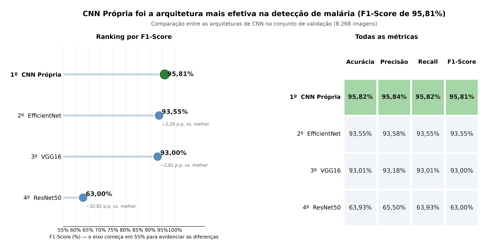
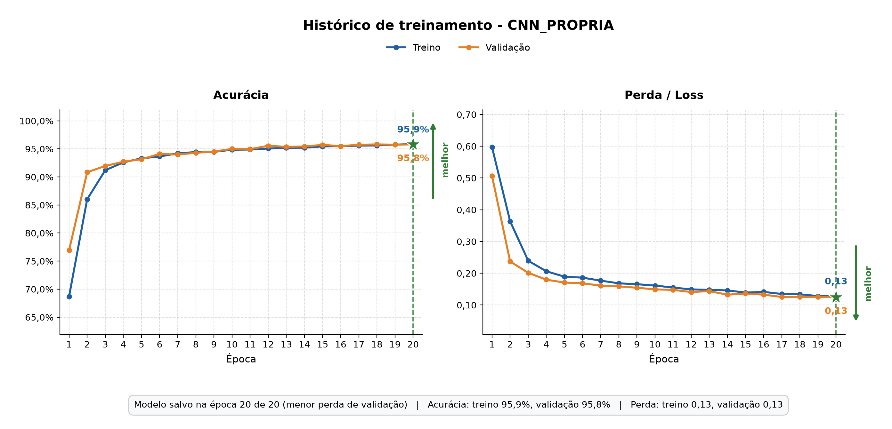
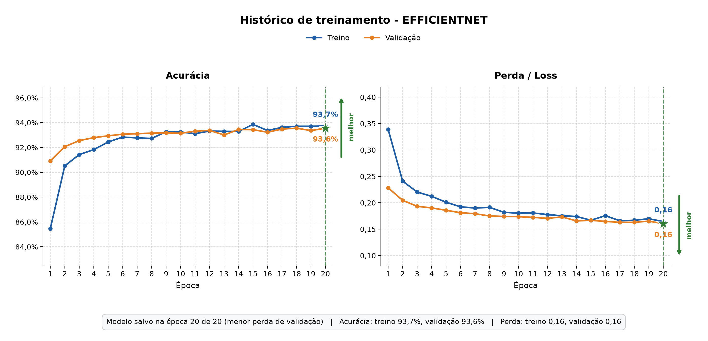
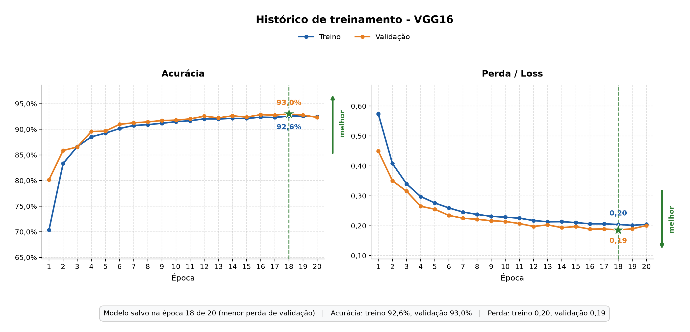
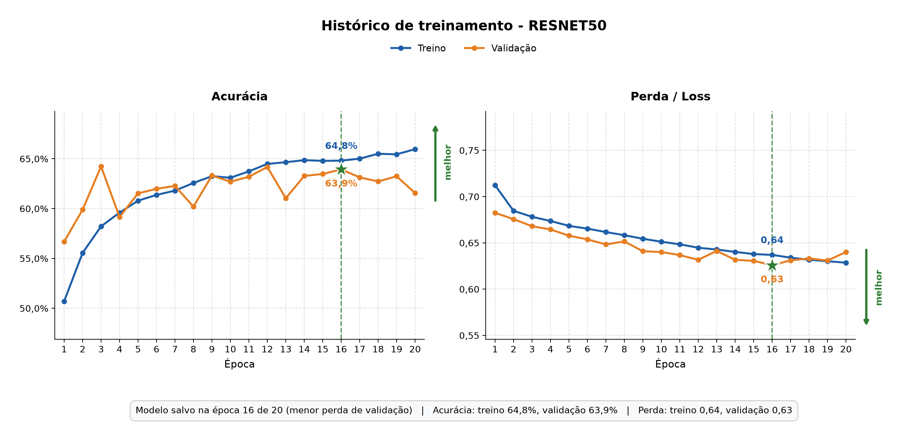

# Detecção de malária em células sanguíneas usando CNNs

Projeto de Trabalho de Conclusão de Curso (TCC) para classificar imagens
microscópicas de células sanguíneas como parasitadas ou não parasitadas e
comparar o desempenho de diferentes arquiteturas de redes neurais
convolucionais.

**Artigo:** [Inteligência artificial na detecção de malária: estudo comparativo de redes neurais convolucionais em imagens de células sanguíneas](docs/artigo_TCC.pdf)

## Status do Projeto

Há uma rodada **histórica e preliminar**, com 70% das imagens para treino e
30% para validação. Seus números e gráficos estão preservados abaixo. A
validação também selecionou a melhor época (`val_loss`): esses números não
estimam desempenho em teste independente.

A [auditoria técnica da PR #2](docs/auditoria_PR2.md) confirmou que VGG16 e
ResNet50 receberam pré-processamento incompatível com seus pesos ImageNet.
O código foi corrigido, mas **ainda não há métricas da rodada corrigida**.
Não está demonstrado quanto esse erro contribuiu para os 63,93% da ResNet50.

## Visão Geral do Projeto

- **CNN Própria:** treinamento integral, inicialização aleatória.
- **VGG16, ResNet50 e EfficientNetB0:** extração de características com bases
  ImageNet congeladas e cabeças classificadoras treináveis; sem fine-tuning.

Manter 128 × 128 pixels, lote 32, Adam com taxa 0,0001, no máximo 20 épocas e
parada antecipada comum não torna os modelos equivalentes: têm pré-treinamento,
capacidades e números de parâmetros treináveis distintos. A comparação é entre
**essas configurações**, não uma prova de superioridade intrínseca das arquiteturas.
128 × 128 é uma resolução experimental comum, não a resolução padrão 224 × 224
do pré-treinamento; não é, por si só, uma entrada inválida com `include_top=False`.

O novo fluxo registra a divisão em manifesto, treina novos modelos e avalia
**teste por padrão**. A validação serve à seleção dos pesos. Resultados de
validação podem ser obtidos explicitamente com `--conjunto val`, como preliminares.

## Obter o Repositório

```bash
git clone https://github.com/alecarvalho950/TCC.git

cd TCC
```

## Estrutura de Pastas

O dataset, os pesos e as rodadas geradas não são versionados. Estrutura da
nova rodada (os gráficos antigos em `codigos/grafico_*.png` são históricos):

```text
TCC/
├── README.md
├── requirements.txt
├── docs/
│   ├── artigo_TCC.pdf              # artigo da rodada histórica; ver auditoria
│   └── auditoria_PR2.md
├── tests/
├── codigos/
│   ├── dividir_dados.py
│   ├── treinamento.py
│   ├── preprocessamento.py
│   ├── protocolo.py
│   ├── avaliacao.py
│   ├── comparar_modelos.py
│   └── resultados/corrigido_seed123/  # novos pesos, metadados e saídas
└── dados/
    ├── originais/
    │   ├── Parasitized/
    │   └── Uninfected/
    └── protocolo_v1/
        ├── manifesto.json
        ├── train/                  # ambas as classes
        ├── val/                    # ambas as classes
        └── test/                   # ambas as classes
```

## Download do Dataset

As imagens não acompanham este repositório devido ao tamanho do dataset.
Baixe-as na página oficial do Kaggle:

[Cell Images for Detecting Malaria — Kaggle](https://www.kaggle.com/datasets/iarunava/cell-images-for-detecting-malaria/data)

Depois de baixar e extrair o arquivo:

1. Localize as pastas de classes `Parasitized` e `Uninfected` dentro do dataset.
2. Copie **somente essas duas pastas** para `dados/originais/`.
3. Confirme que os caminhos ficaram `dados/originais/Parasitized/` e
   `dados/originais/Uninfected/`, sem uma pasta intermediária extra.

Se a extração contiver cópias aninhadas de `cell_images`, use apenas uma
cópia das classes. A nova divisão recusa conteúdos com SHA-256 idêntico,
inclusive sob nomes diferentes; isso não detecta todas as duplicatas visuais.

No Windows PowerShell, a pasta de destino pode ser criada com:

```powershell
New-Item -ItemType Directory -Force dados/originais
```

Em macOS ou Linux:

```bash
mkdir -p dados/originais
```

## Configuração do Ambiente e Instalação

Abra um terminal na raiz do repositório. O código corrigido foi verificado com
Python 3.12 e TensorFlow 2.20 em CPU/Linux. As versões em `requirements.txt`
referem-se a essa verificação funcional, não ao ambiente desconhecido da rodada
histórica. Disponibilidade de GPU e instalação podem variar por plataforma.

### Windows (PowerShell)

Crie e ative um ambiente virtual:

```powershell
python -m venv venv
.\venv\Scripts\Activate.ps1
```

Se o PowerShell bloquear a ativação de scripts, consulte as instruções de
execução de scripts da sua organização ou use o Prompt de Comando:

```bat
venv\Scripts\activate.bat
```

### macOS ou Linux

Crie e ative um ambiente virtual:

```bash
python3 -m venv venv
source venv/bin/activate
```

### Instalar dependências

Com o ambiente virtual ativado, atualize o `pip` e instale as bibliotecas
listadas no `requirements.txt`:

```bash
python -m pip install --upgrade pip
python -m pip install -r requirements.txt
```

## Passo a Passo para Execução

### 1. Criar uma nova divisão sem alterar as pastas históricas

Use uma cópia limpa e única do dataset em `dados/originais/`. Não redistribua
`dados/train` e `dados/val` antigos para depois avaliar os pesos antigos: eles
podem já ter visto as imagens que passariam a ser chamadas de teste.

**Preferência: separar por paciente**, com identificadores de origem verificados.
Forneça um CSV `dados/grupos.csv` com colunas `arquivo,grupo`, uma linha por
imagem, caminho relativo à origem (com `/`), e o mesmo grupo para todas as
células do mesmo paciente, inclusive entre classes. Não deduza pacientes apenas
por semelhança de nomes. O repositório não fornece esse mapeamento.

```bash
python codigos/dividir_dados.py --origem dados/originais --grupos dados/grupos.csv
python codigos/dividir_dados.py --origem dados/originais --grupos dados/grupos.csv --executar
```

A divisão por grupo visa aproximadamente 70/15/15; os percentuais de imagens e
a proporção das classes podem variar. As contagens reais são exibidas; ambas
as classes precisam estar presentes em cada partição. O manifesto registra
caminhos, rótulos, grupos e hashes. O destino deve ser novo; nada é movido da fonte.

Sem metadados de paciente, pode-se fazer **somente uma divisão exploratória por
imagem**, estratificada por classe, com cerca de 70/15/15:

```bash
python codigos/dividir_dados.py --origem dados/originais --por-imagem --executar
```

Essa opção **não garante independência entre pacientes/lâminas**. Nenhum número
do novo teste foi calculado. Se o corpus já foi explorado no estudo, esse teste
interno reservado aos novos pesos não substitui uma confirmação externa em
pacientes e fontes de aquisição ainda não utilizados.

### 2. Treinar os quatro modelos novamente

```bash
python codigos/treinamento.py
```

A entrada de todos os modelos é RGB 0–255. O aumento de dados atua somente no
treino, antes do pré-processamento específico, incorporado ao modelo salvo:

| Modelo | Entrada efetiva da base |
|---|---|
| CNN Própria | RGB dividido por 255 |
| VGG16 | `vgg16.preprocess_input`: RGB → BGR, subtração das médias ImageNet, sem divisão por 255 |
| ResNet50 | `resnet50.preprocess_input`: RGB → BGR, subtração das médias ImageNet, sem divisão por 255 |
| EfficientNetB0 | RGB 0–255; pré-processamento interno da própria base |

Não normalize novamente na avaliação. A camada personalizada é registrada pelo
módulo `preprocessamento.py`; carregamentos fora dos scripts devem importar esse
módulo antes de `load_model`. Os `.keras` antigos permanecem históricos e não
são convertidos em modelos corrigidos apenas por modificar o código.

Cada arquitetura recebe instâncias novas de augmentation e reinicia semente e
ordem de embaralhamento. As bases ImageNet ficam congeladas e são chamadas com
`training=False`. Early stopping e checkpoint usam **menor `val_loss`**, paciência
5; a ordenação comparativa usa **F1 ponderado**. São critérios distintos e explícitos.
O teste não participa de `fit`, da parada antecipada ou do ajuste de limiares.

A saída padrão é `codigos/resultados/corrigido_seed123/`. O script recusa pasta
existente. Salva histórico numérico, melhor época, configuração, versões,
hashes do código, do manifesto e do modelo. As métricas Keras de precisão/recall
sobre saídas one-hot foram retiradas do treinamento para não serem confundidas
com médias ponderadas ou sensibilidade da classe parasitada.

Para repetir **o treinamento** com outra semente e a mesma divisão:

```bash
python codigos/treinamento.py --seed 456 --saida codigos/resultados/corrigido_seed456
```

### 3. Avaliar e comparar em teste

Depois de congelar o protocolo e as escolhas usando apenas treino/validação:

```bash
python codigos/avaliacao.py
python codigos/comparar_modelos.py
```

Ambos usam `test` por padrão e exigem os quatro modelos com proveniência
compatível. As saídas ficam em `avaliacao_test/` dentro da rodada: matrizes,
relatórios, tabela CSV sem arredondamento e gráfico descritivo. Predições por
imagem e probabilidades são salvas em `.npz`, com classes e caminhos, permitindo
análises pareadas posteriores. Não altere o protocolo em função dos resultados
do teste e depois reutilize esse mesmo teste como confirmação independente.

`Parasitized` é a classe positiva (índice 0). A decisão é `argmax` da softmax.
Precisão/recall/F1 da tabela são ponderados pelo suporte das classes; o recall
ponderado coincide com a acurácia nesta classificação de rótulo único. As
figuras de matrizes mostram precisão/F1 **da classe positiva**, não essa média.
O CSV inclui sensibilidade, especificidade, VP/VN/FP/FN, F1 macro, ROC AUC e
average precision da classe parasitada. Médias ponderadas não substituem a
análise de falsos negativos. Não há intervalos de confiança ou testes de
significância implementados.

Outras pastas podem ser indicadas com `--dados` e `--modelos-dir` em ambos os
scripts. Para diagnóstico da validação, acrescente `--conjunto val`; as saídas
serão separadas em `avaliacao_val/` e identificadas como preliminares.

### Verificação funcional

```bash
python -m unittest discover -s tests -v
```

Inclui transformação numérica de pixels, salvamento/recarregamento das quatro
arquiteturas sem baixar ImageNet (`weights=None` apenas nos testes), métricas
com respostas conhecidas, separação por grupos e rejeição de dados/pesos
incompatíveis. Isso **não é treinamento experimental nem avaliação do dataset**.

## Resultados

**Rodada histórica, anterior às correções. Nenhuma métrica nova é apresentada.**

Métricas **informadas na PR** para validação (8.268 imagens), atribuídas ao
`comparar_modelos.py` original. Não foram recalculadas nesta auditoria: dataset,
pesos, predições e CSV da rodada não estão versionados. Precisão, *recall* e *F1-score* correspondem à média
ponderada das duas classes.

| Modelo | Acurácia | Precisão | Recall | F1-score |
|---|---|---|---|---|
| CNN Própria | 95,82% | 95,84% | 95,82% | 95,81% |
| EfficientNetB0 | 93,55% | 93,58% | 93,55% | 93,55% |
| VGG16 | 93,01% | 93,18% | 93,01% | 93,00% |
| ResNet50 | 63,93% | 65,50% | 63,93% | 63,00% |

A CNN própria teve o maior valor observado nessa execução. Isso não demonstra
superioridade geral, significância estatística, desempenho clínico ou que a
ResNet50 seja inadequada para a tarefa. O erro de pré-processamento é comprovado;
a magnitude e a causalidade do seu efeito exigem experimento controlado.

O protocolo antigo destinava **30% de cada classe** à validação em um dataset
balanceado: 4.134 imagens por classe, somando 8.268 de 27.558. A expressão antiga
“15% do total de cada classe” referia-se a cada classe contribuindo com 15% do
**dataset total**, não a uma fração de validação de 15%.

### Comparação geral (histórica)

O título afirmativo da imagem antiga deve ser lido com as ressalvas acima.
Ela foi preservada como registro; o código corrigido gera títulos descritivos.



### Histórico de treinamento (rodada histórica)

| CNN Própria | EfficientNet |
|---|---|
|  |  |
| **VGG16** | **ResNet50** |
|  |  |

As matrizes e o CSV da rodada histórica não acompanham o ramo auditado. Devem
ser recuperados dos arquivos originais, sem substituição por resultados do novo
protocolo. O artigo em PDF também descreve a rodada histórica; sua discussão
sobre o efeito do pré-processamento deve ser lida conforme a
[nota de correção e as pendências](docs/auditoria_PR2.md#artigo-em-pdf).

## Referências Bibliográficas

As arquiteturas utilizadas neste estudo são fundamentadas em trabalhos
acadêmicos que investigam profundidade, conexões residuais e escalabilidade
eficiente em redes neurais convolucionais.

### VGG16 — Very Deep Convolutional Networks for Large-Scale Image Recognition

Empilha convoluções pequenas de 3 × 3 para investigar como o aumento da
profundidade melhora o reconhecimento de imagens em larga escala.

- **Autores:** Karen Simonyan e Andrew Zisserman (2014)
- **Artigo original:** [Acessar no arXiv](https://arxiv.org/abs/1409.1556)

### ResNet50 — Deep Residual Learning for Image Recognition

Introduz conexões residuais, que facilitam o treinamento de redes profundas e
ajudam a lidar com a degradação da acurácia à medida que a profundidade aumenta.

- **Autores:** Kaiming He, Xiangyu Zhang, Shaoqing Ren e Jian Sun (CVPR 2016)
- **Artigo original:** [Acessar no CVF Open Access](https://www.cv-foundation.org/openaccess/content_cvpr_2016/html/He_Deep_Residual_Learning_CVPR_2016_paper.html)

### EfficientNet — Rethinking Model Scaling for Convolutional Neural Networks

Propõe o escalonamento composto, que ajusta de forma coordenada profundidade,
largura e resolução para equilibrar desempenho e custo computacional.

- **Autores:** Mingxing Tan e Quoc V. Le (ICML 2019)
- **Artigo original:** [Acessar no PMLR](https://proceedings.mlr.press/v97/tan19a.html)

## Autores

- Alejandro Carvalho — [@alecarvalho950](https://github.com/alecarvalho950)
- Ângela Kretschmann — [@angelakretschmann](https://github.com/angelakretschmann)
- Giliard Gomes Martins — [@Gili10](https://github.com/Gili10)

## Orientador

- Prof. Gian Brustolin
